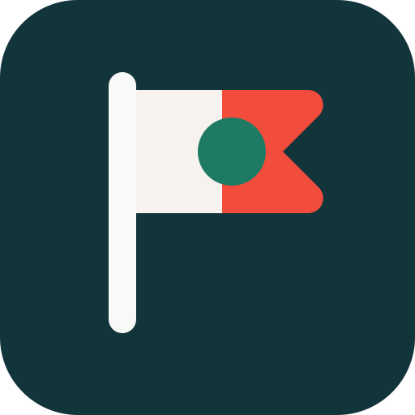
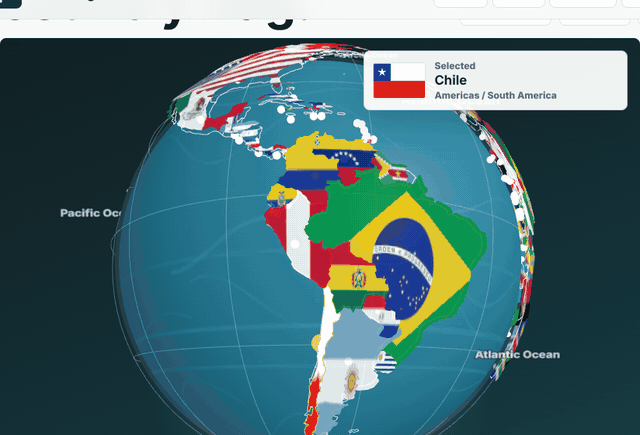
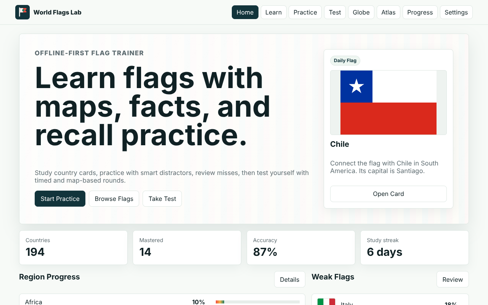
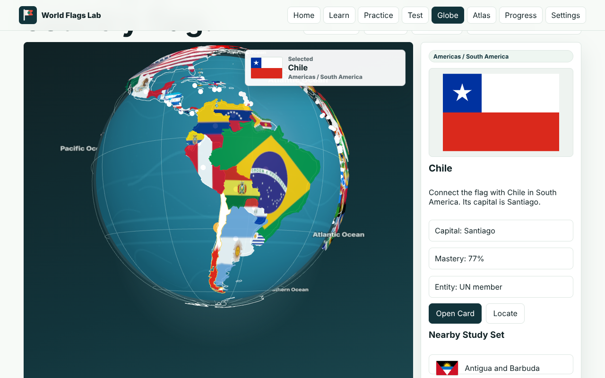
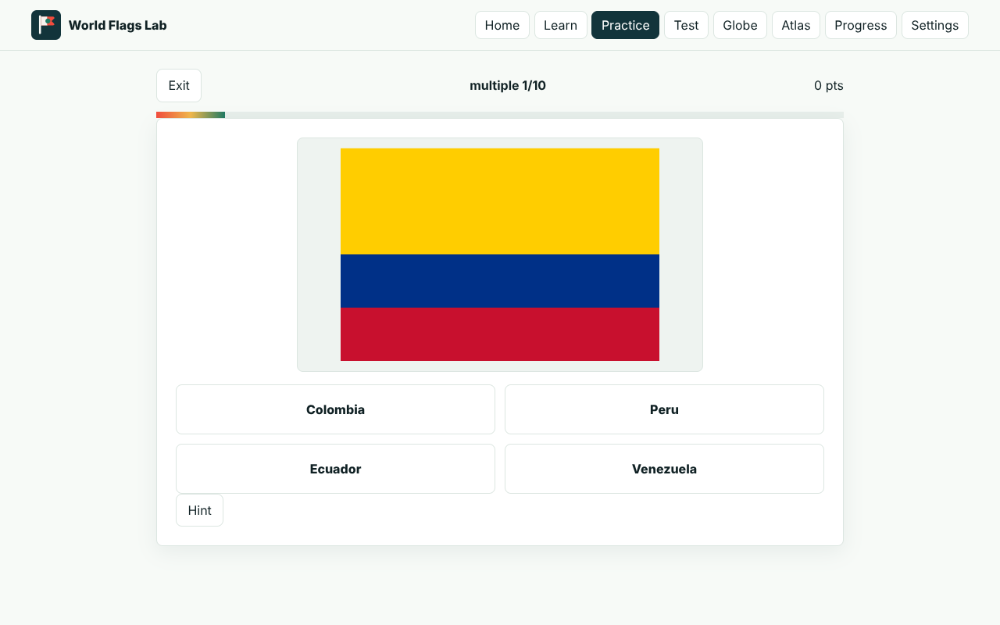
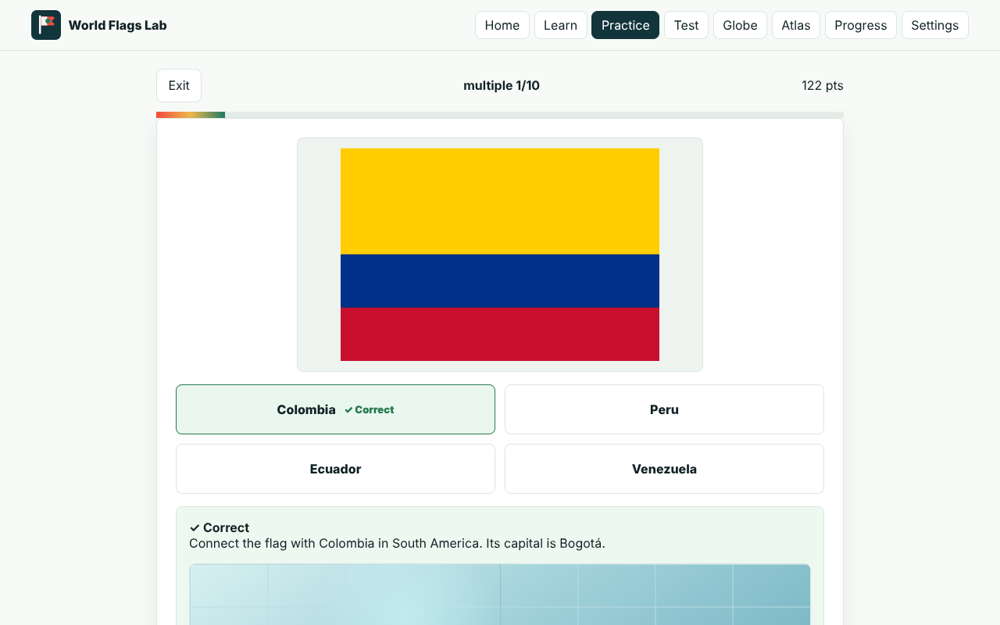
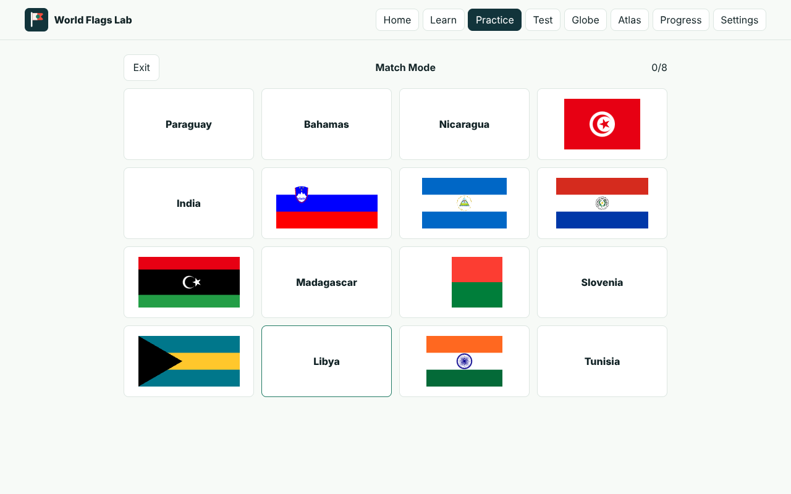
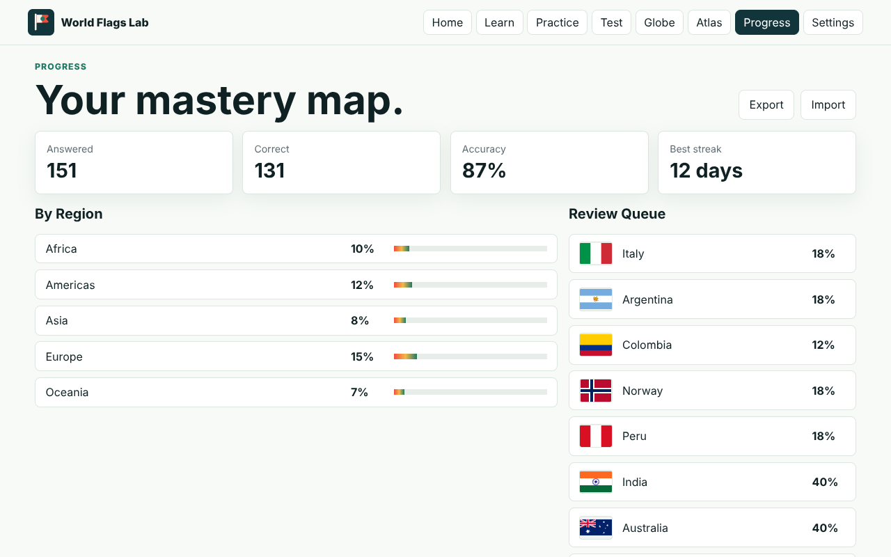
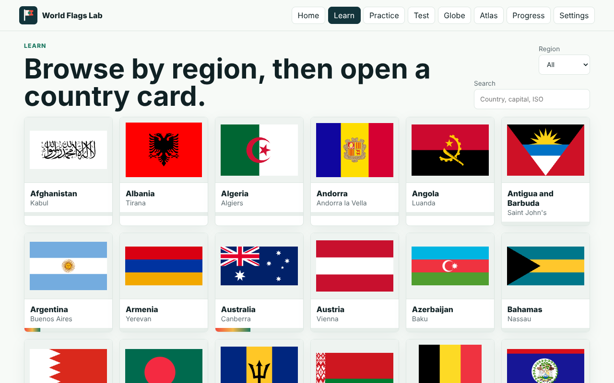

<div align="center">



# 🌍 World Flags Lab

### *194 nations. 250 flags. One spinning planet. Zero excuses.*

**Learn every flag on Earth, pin it to the map, and drill it until it's burned into your brain.**

[**▶ Launch the app**](https://world-flags-lab.netlify.app) · [Report a bug](https://github.com/ChrisBrooksbank/world-flags-lab/issues) · Offline-first PWA · No account · No ads · No tracking



</div>

---

## 🏴 Why flags?

A flag is a country compressed into a rectangle. Three stripes can carry a revolution, a star can carry a dream of unity, a single red disc can carry two thousand years of mythology. Once you can read them, the world stops being a list of names and turns into a wall of stories.

World Flags Lab is a training ground for that skill. You don't just memorise flags here: you **spin the globe**, **find them on the map**, **fight the lookalikes**, and **track your mastery** until Chad and Romania stop being a coin flip.

---

## ✨ What's inside

| | |
|---|---|
| 🌐 **3D Globe Explorer** | Every country is wrapped in its own flag on a hand-lit Three.js globe. Drag, pinch, scroll, hover. Tap land and it tells you where you are. |
| 🧠 **Learn** | Country cards with capitals, regions, population, languages, currency, flag descriptions and memory hooks. |
| 🎯 **Practice** | Flag → Country, Country → Flag, Blur Mode, Similar Flags, Map Locator, Mistake Review and Match Mode. |
| ⏱️ **Test** | Timed 20-question exams, a reverse exam, a map exam, and **Ultimate Mode**: name the flag, pick the capital, *then* find it on the map. |
| 📈 **Progress** | Per-flag mastery, accuracy, a review queue of the flags you keep missing, study streaks, round history, and JSON import/export. |
| 📴 **Offline-first** | Installs as a PWA. After the first visit every flag, outline and fact is cached on your device. Works on a plane. |
| 🔒 **Private** | Your progress lives in your browser. There's no server, no login, and nothing to sell. |

---

## 📸 Tour

<table>
<tr>
<td width="50%"><br/><sub><b>Home</b>: the daily flag, your streak, and the flags that need work.</sub></td>
<td width="50%"><br/><sub><b>Globe</b>: South America, painted in its own colours.</sub></td>
</tr>
<tr>
<td><br/><sub><b>Practice</b>: same-region distractors, so you can't guess from the continent.</sub></td>
<td><br/><sub><b>Instant feedback</b>: a ✓/✗ cue, a memory hook, and the country's spot on the map.</sub></td>
</tr>
<tr>
<td><br/><sub><b>Match Mode</b>: eight flags, eight names, pair them all.</sub></td>
<td><br/><sub><b>Progress</b>: mastery by region and a review queue built from your misses.</sub></td>
</tr>
<tr>
<td colspan="2"><br/><sub><b>Learn</b>: browse the whole world one region at a time.</sub></td>
</tr>
</table>

---

## 📜 A very short history of flags

**Before cloth, there were standards.** Around 3000 BC, Egyptian and Mesopotamian armies carried *vexilloids*: carved animals, feathers or metal emblems on poles that told soldiers where to rally. Rome's legions marched behind the eagle-topped *aquila*, and losing one was a disaster. The word *vexillology*, the study of flags, comes from the Roman *vexillum*, a square cloth banner hung from a crossbar.

**Then silk took over.** Chinese dynasties were flying silk banners in battle centuries before Europe was. Silk was light, it took dye well, and it moved in the wind, so a commander could be seen from across a battlefield. Traders on the Silk Road carried the idea west.

**Medieval Europe made it personal.** Knights in full armour were impossible to tell apart, so heraldry grew up to fix that: lions, crosses and chevrons in strict colours on shields, surcoats and banners. Plenty of today's flags still follow those old rules. The crosses on England's St George's flag and Scotland's Saltire both started out as heraldic marks.

**The oldest national flag still flying** is usually said to be **Denmark's Dannebrog**. Legend has it the white cross on red fell from the sky during a battle in 1219. Every Nordic cross flag in Sweden, Norway, Finland and Iceland descends from it.

**Ships made flags global.** In the age of sail, a ship needed to say who it was from a mile away, and maritime ensigns became the template for national flags. The **Dutch tricolour** of the late 1500s, first orange-white-blue and later red-white-blue, helped start the craze for simple horizontal stripes.

**Revolutions brought the tricolour.** In 1790 France adopted the blue-white-red *tricolore*. Its three equal bands stood for liberty, equality and fraternity, and the design spread. Italy, Ireland, Mexico, Romania and dozens of others followed with tricolours of their own, each colour carrying a political meaning.

**The 20th century went pan-everything.** As empires broke up, new nations picked colours that tied them to a bigger idea:
- 🟢🟡🔴 **Pan-African colours** came from Ethiopia, one of only two African nations never colonised, and Ghana took them up in 1957.
- 🟥⬛⬜🟩 **Pan-Arab colours** trace back to the Arab Revolt flag of 1916.
- ⬜🟦 **Pan-Slavic colours** echo the Russian civil ensign.

That's why you keep mixing up Ghana, Cameroon, Senegal, Mali and Guinea, or Egypt, Iraq, Syria and Yemen. **It's on purpose.** Those flags were *meant* to look related, and World Flags Lab has a whole mode built for the confusion.

**A few oddballs to win you a pub quiz:**
- 🇳🇵 **Nepal**'s is the only non-rectangular national flag: two stacked pennants.
- 🇨🇭 **Switzerland** and 🇻🇦 **Vatican City** fly square flags.
- 🇹🇩 **Chad** and 🇷🇴 **Romania** are almost identical; the blue is a shade different.
- 🇲🇨 **Monaco** and 🇮🇩 **Indonesia** are the same red over white, just in different proportions.
- 🇵🇾 **Paraguay**'s flag has a different emblem on the front and the back.
- 🇲🇿 **Mozambique** has an AK-47 on its flag.
- 🇧🇹 **Bhutan** has a thunder dragon.

Every one of those is in the app. Go find them on the globe.

---

## 🚀 Run it locally

It's a static app with no build step: clone it, serve it, and it runs.

```bash
git clone https://github.com/ChrisBrooksbank/world-flags-lab.git
cd world-flags-lab
npm run serve        # python -m http.server 4173
```

Open **http://localhost:4173/** and start spinning.

Regenerate country data and flag SVGs from REST Countries:

```bash
npm run build:data
```

---

## 🛠️ How it's built

- **Vanilla JS + HTML + CSS**, with no framework and no bundler. One `app.js` renders every view from a single state object.
- **Three.js**, vendored locally in `vendor/three.module.js`, draws the globe. Country polygons from GeoJSON are triangulated, projected onto the sphere and textured with each flag's SVG. Clicking runs a point-in-polygon test on the ray hit, so it knows which country you tapped even with no marker nearby.
- **Service worker** (`sw.js`): network-first for the app shell, cache-first for flags, data and the engine, with an in-app "Update ready" prompt when a new version ships.
- **localStorage** holds progress, with import and export for moving between devices.

```text
.
├── index.html               # boot shell
├── manifest.webmanifest     # PWA manifest
├── sw.js                    # offline caching + update flow
├── src/
│   ├── app.js               # all views, quizzes, globe, progress
│   └── styles.css
├── public/
│   ├── data/countries.json  # generated country dataset
│   ├── flags/*.svg          # 250 local flag assets
│   └── maps/countries.geojson
├── scripts/build-data.mjs   # REST Countries → local data + flags
├── vendor/three.module.js
└── docs/media/              # README screenshots & GIF
```

---

## ☁️ Deploy

It's hosted on **Netlify** as a static site ([`netlify.toml`](./netlify.toml)) and publishes from the repo root.

```bash
npx netlify deploy --prod --dir .
```

---

## 🗺️ Roadmap

- 📖 Curated symbolism and history notes for every flag
- 🔊 Pronunciation audio for countries and capitals
- 🏫 Classroom mode with shareable progress exports
- 🌐 Multilingual UI

---

<div align="center">

**MIT licensed.** Data from [REST Countries](https://restcountries.com). Built for people who stop at every embassy to check the flag.

*Now go spin the planet.* 🌍

</div>
